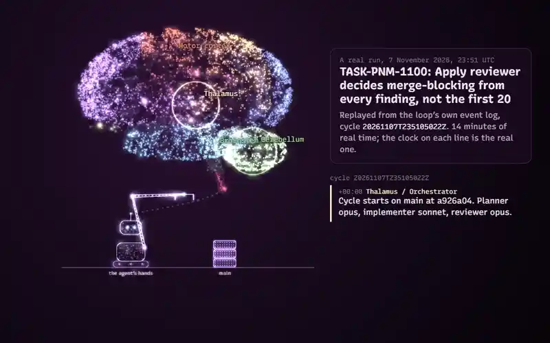

# Taejin Jung

Software engineer in Toronto. I build desktop software that has to stay fast while something heavier runs beside it,
and tools that let coding agents work unattended without being trusted blindly.

Since 2021 I have worked at [Insights.gg](https://insights.gg) on Insights Capture, an Electron and TypeScript/React
app that records gameplay, detects highlights and supports team video review, on a platform serving 140K+ daily
active users. I own features from requirements to release: the desktop client, the REST APIs behind recording upload
and clip sharing, and the performance and crash work that keeps recording smooth while a game is running.

## What I am building

### [Creator Assist](https://github.com/taejin5314/claude-codex-loop-engineering): coding agents that merge on their own, safely

A local orchestrator that runs the whole loop (plan, implement, check, independent review, fix, merge) with Claude
Code and Codex, and stops to ask a human when a decision is risky.

- **More than 1,000 changes merged to `main` by the loop itself** in eight weeks, 69% of them on the first attempt, with a
  median of about 10 minutes from start to `main`.
- **354 times it stopped and asked** instead of guessing. A boundary gate rejected 315 attempts that touched files
  outside their task, and an independent reviewer sent 392 changes back.
- **249 architecture decision records**, each tied to the measurement or incident behind it, and 389 test files
  gating every pull request.

### [autoMeetic](https://github.com/taejin5314/autoMeetic): a real-time AI meeting copilot

An Electron desktop app that captions a call live, translates it, draws the discussion on a whiteboard as it
happens, and keeps a searchable memory of every meeting. Transcripts are stored in SQLite with embeddings computed
on the device, so "what did we decide about X?" is answered with citations and no transcript is sent to an embedding
service. 384 tests.

### [ikea-mcp](https://github.com/taejin5314/ikea-mcp): an open-source MCP server, published on npm

`npx ikea-mcp` gives an AI assistant nine tools for IKEA product search and live store stock in the US and Canada,
including "which store can fill this whole cart?". Two transports (stdio and Streamable HTTP), bounded fan-out with
retries, and errors returned as data so an assistant can explain a partial answer.

## How I work

- **Decisions are written down before the code.** A change in design starts as a short record of the problem, the
  options and the evidence, so the next person, or the next agent, does not have to guess why.
- **Claims come with evidence.** "Done" means a check ran and passed, with the command and its exit code. I measure
  before I optimize and again after.
- **Agents get boundaries, not trust.** I give them small tasks, the files they may touch and a gate they cannot
  talk their way past, then let them run.
- **Small changes, shipped often.** One goal per change, reviewed by someone, or something, that did not write it.

## Tools I reach for

- Languages and runtime: TypeScript, JavaScript, Python, SQL, Node.js
- Product: React, Electron, REST APIs, PostgreSQL, MongoDB, SQLite
- Delivery: Vitest, GitHub Actions, Docker
- AI tooling: Claude Code, Codex, OpenAI Realtime API, Model Context Protocol

## Contact

[LinkedIn](https://www.linkedin.com/in/taejin-jung-0abb42114/)
